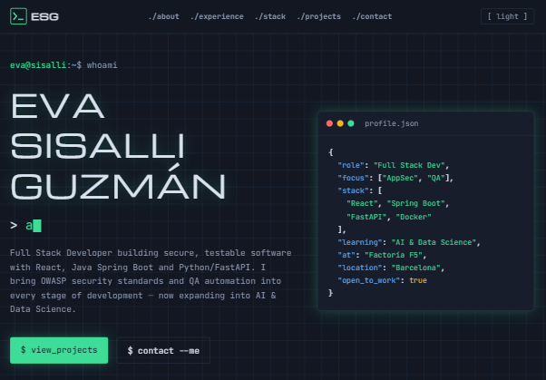
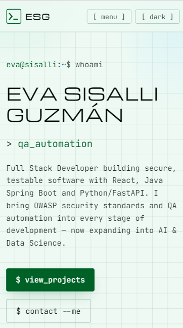
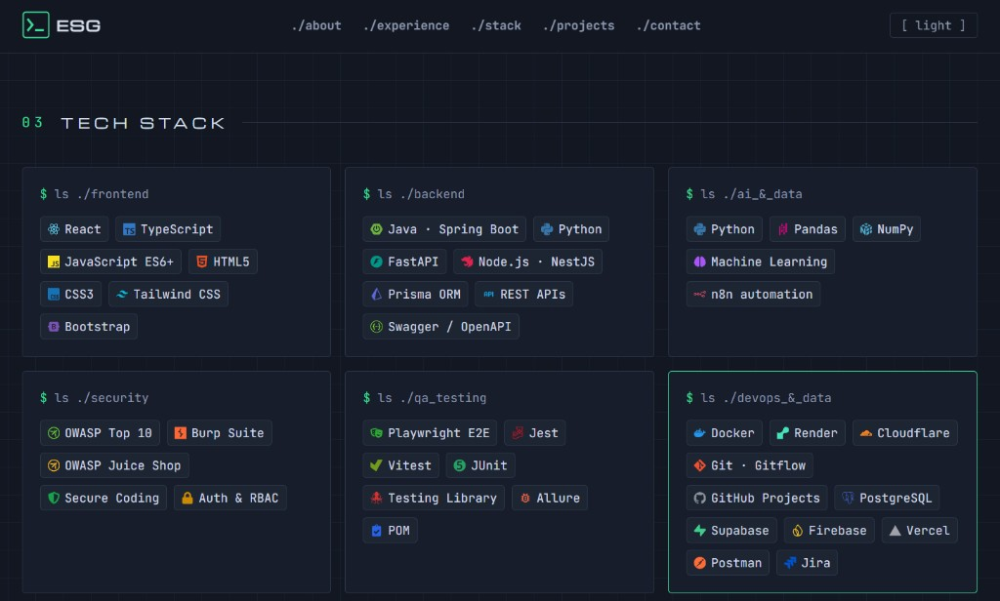
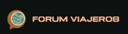
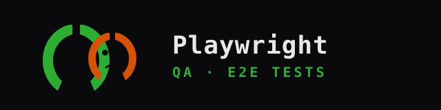

# Eva Sisalli Guzmán — Portfolio

[](https://nextjs.org/)
[](https://react.dev/)
[](https://tailwindcss.com/)
[](https://www.typescriptlang.org/)
[](https://playwright.dev/)
[](#)

🇪🇸 Portfolio personal con estética **terminal / IDE**: dark & light mode, tipografía mono, focos en **Full Stack**, **AppSec** y **QA Automation**.

🇬🇧 Personal portfolio with a **terminal / IDE** look: dark & light mode, mono type, focused on **Full Stack**, **AppSec** and **QA Automation**.

**Live:** [portfolio-eva-five.vercel.app](https://portfolio-eva-five.vercel.app)  
**Contact:** [e.sisalli@yahoo.com](mailto:e.sisalli@yahoo.com) · [GitHub](https://github.com/miskybox) · [LinkedIn](https://www.linkedin.com/in/eva-sisalli-guzman/)

---

## Preview

### Dark mode



### Light mode



### Tech Stack



---

## About | Sobre el proyecto

🇪🇸 Sitio one-page que presenta mi perfil como **Full Stack Developer** (React, Java Spring Boot, Python/FastAPI), con énfasis en:

- Código limpio y testeable
- Estándares **OWASP** desde etapas tempranas
- Automatización **QA** con Playwright
- Formación actual en **AI & Data Science** (Factoría F5)

🇬🇧 One-page site presenting my profile as a **Full Stack Developer** (React, Java Spring Boot, Python/FastAPI), with focus on:

- Clean, testable code
- **OWASP** standards from early stages
- **QA** automation with Playwright
- Currently studying **AI & Data Science** (Factoría F5)

🇪🇸 / 🇬🇧 Content (copy, stack, projects, links) lives in [`src/content/portfolio.ts`](src/content/portfolio.ts).

---

## Features | Características

| ES | EN |
| --- | --- |
| Estética terminal (`whoami`, `$ view_projects`, nav `./about`…) | Terminal aesthetic (`whoami`, `$ view_projects`, `./about` nav…) |
| Dark / light con contraste accesible | Dark / light with accessible contrast |
| Responsive sin scroll horizontal | Responsive with no horizontal scroll |
| Previews de proyecto clicables (demo / live / repo) | Clickable project previews (demo / live / repo) |
| Iconos de marca en el tech stack | Brand icons in the tech stack |
| Cabeceras de seguridad (CSP, etc.) en Next.js | Security headers (CSP, etc.) in Next.js |
| Vitest + Playwright E2E + axe | Vitest + Playwright E2E + axe |

---

## Site tech stack | Stack del sitio

| Layer / Capa | Tech |
| --- | --- |
| Framework | Next.js 15 (App Router) |
| UI | React 19 · Tailwind CSS v4 |
| Language / Lenguaje | TypeScript |
| Icons / Iconos | react-icons |
| Fonts / Fuentes | JetBrains Mono · Michroma |
| Deploy | Vercel |
| Tests | Vitest · Playwright · axe-core |

---

## Featured projects | Proyectos destacados

| | Project | ES | EN | Links |
| :---: | --- | --- | --- | --- |
|  | **cancha-dt** | Pizarra táctica 2D (PWA) para fútbol amateur y base | 2D tactics board (PWA) for amateur & youth football | [Demo](https://dev-futbol-total.miskybox.workers.dev/) |
|  | **forum-viajeros** | SPA de relatos y comunidad viajera | Travel stories & community SPA | [Web](https://www.forumviajeros.com/) · [Code](https://github.com/miskybox/Forum_frontend) |
|  | **playwright-qa-tests** | Suite E2E risk-based (Polymer Shop) | Risk-based E2E suite (Polymer Shop) | [Code](https://github.com/miskybox/project-qa-tests) |

---

## Getting started | Arranque local

```bash
npm install
npm run dev
```

Open / Abre [http://localhost:3000](http://localhost:3000).

```bash
npm run build && npm start   # production locally / producción local
```

---

## Scripts

| Command | ES | EN |
| --- | --- | --- |
| `npm run dev` | Servidor de desarrollo | Dev server |
| `npm run build` | Build de producción | Production build |
| `npm start` | Sirve el build | Serve the build |
| `npm run lint` | ESLint (Next.js) | ESLint (Next.js) |
| `npm test` | Vitest (contenido / integridad) | Vitest (content integrity) |
| `npm run test:e2e` | Playwright E2E + a11y | Playwright E2E + a11y |

---

## Structure | Estructura

```text
src/
  app/           # layout, page, globals.css, icon
  components/    # header, logo, theme toggle, tech chips…
  content/       # portfolio.ts ← edit here / edita aquí
public/
  projects/      # project logos / logos de proyectos
docs/
  screenshots/   # README screenshots / capturas
e2e/             # Playwright
```

---

## Security & accessibility | Seguridad & accesibilidad

🇪🇸

- Skip link, landmarks semánticos y `rel="noopener noreferrer"` en enlaces externos
- Contraste revisado en light/dark (texto de cuerpo, cards de proyectos)
- CSP y cabeceras HTTP en `next.config.ts` (`unsafe-eval` solo en desarrollo)
- Checks E2E con axe-core

🇬🇧

- Skip link, semantic landmarks, `rel="noopener noreferrer"` on external links
- Contrast reviewed in light/dark (body text, project cards)
- CSP & HTTP headers in `next.config.ts` (`unsafe-eval` only in development)
- E2E checks with axe-core

---

## License | Licencia

🇪🇸 Uso personal / portfolio. El código puede servir de referencia; el contenido (textos, marca ESG, capturas) es propio.

🇬🇧 Personal / portfolio use. Code may be used as reference; content (copy, ESG brand, screenshots) is owned by the author.
